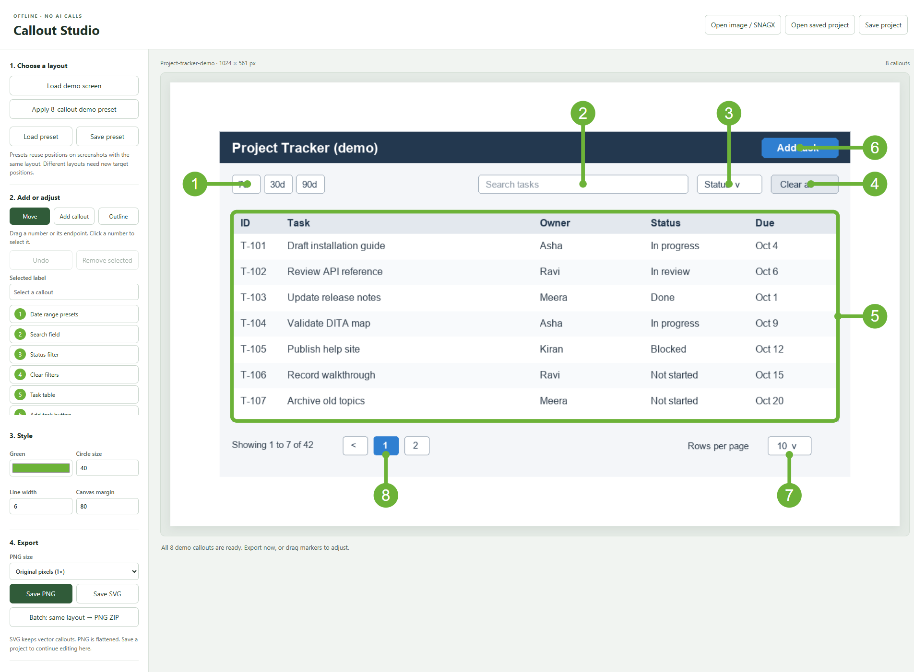

# Local Callout Studio

A small browser tool for adding numbered callouts to screenshots. It runs offline from a folder, needs no install, and makes no network or AI calls.

I built it to cut the repetitive part of documenting software screens: placing numbered markers in the same spots on every release's screenshots. Everything else about a callout, such as which controls deserve one and what the legend says, still needs a writer's judgment.

In my own use, a saved preset cut a batch of about 30 similar screens from a few minutes of placing callouts per image to under a minute of checking positions. A new layout still needs one-time placement, and moved controls still need manual fixes.



## Try it

1. Open `index.html` in Chrome or Edge, or run `Start Callout Studio.cmd` on Windows.
2. The tool opens with a generic demo screen and eight callouts.
3. Drag a number to move it. Select **Save PNG** or **Save SVG** to export.

The demo screen is a drawn mock-up, not a real product.

## Annotate your own screenshot

1. Select **Open image / SNAGX** and choose a PNG, JPG, or WebP file.
2. Select **Add callout**, then click each target in order. Numbers appear in the nearest margin.
3. Use **Move** to adjust. Use **Outline** and drag to mark a region.
4. Select a number in the list to name it or remove it. **Undo** restores the previous edit.
5. Select **Save preset** to keep the layout, or **Save project** to keep the image and callouts together.

## Repeat the layout on new screenshots

Load a preset onto a new screenshot of the same screen. Positions scale to the new image size. For many images, use **Batch: same layout → PNG ZIP**.

Presets assume the same layout and crop. They cannot follow controls that moved, and the tool does not detect controls on its own.

## Formats

| Format | Use |
| --- | --- |
| PNG | Flattened image for manuals. Original pixels by default. The 2× option enlarges the screenshot but adds no detail. |
| SVG | Embedded screenshot with editable vector callouts. Snagit may flatten an imported SVG. |
| Project JSON | Reopens in this tool with the image and callouts. Nothing is stored in the browser automatically. |
| Preset JSON | Layout and style only, with no image. |
| SNAGX input | Reads the background image from a Snagit file. Annotation layers and extra pages are not read. |

## Limits

Up to 200 callouts per image. Images under 48 MB and 40 megapixels. Batches of up to 40 files and 150 MB.

## Privacy

Files stay on the computer. The page blocks outbound connections through its content security policy, and the test suite asserts that no network request is made.

## Tests

`test.cjs` drives the tool in a real browser and checks rendering, pixel fidelity of the unannotated screenshot, dragging, undo, preset and project round trips, validation, escaping of label text, batch export, and zero network requests. It needs Playwright and sharp, which are development-only. The tool itself has no runtime dependencies.

```text
node test.cjs
```

Set `CHROME_PATH` if Chrome is not in its default Windows location. Set `SNAGX_TEST` to also test SNAGX import.
