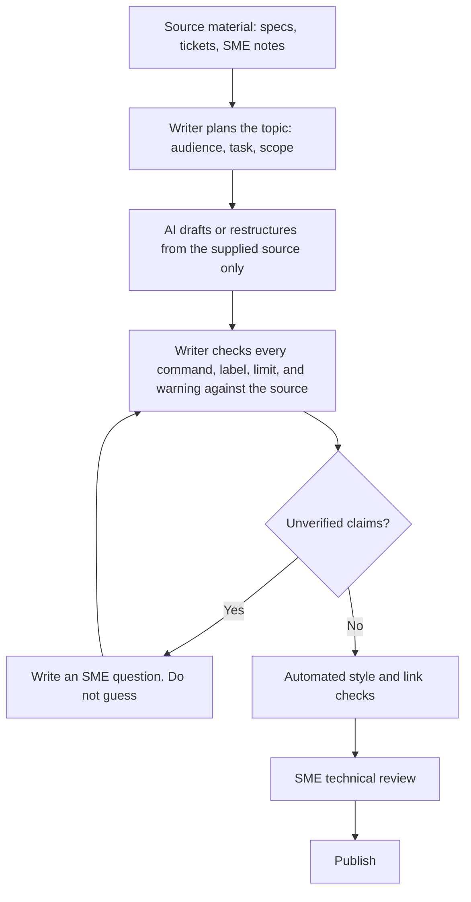

# Use AI in a documentation workflow without losing accuracy

AI tools can draft, restructure, and check documentation quickly. They can also invent a menu label, blur a warning, or make every page sound the same. This sample shows how I use them for the first kind of work and keep humans in charge of the second.

**Audience:** Documentation managers deciding how a team should use AI, and writers adopting it.  
**Shows:** A defined human-in-the-loop process, reusable prompts with review steps, an agent rule file, and a style checklist that needs no AI at all.

## The process

The writer owns steps B, D, and the decision at E. The AI does not decide what the reader needs. It works on the material it is given.

## Rules for using AI on documentation

1. **Give it the source.** Prompts name the input, such as a spec excerpt or a change list. "Write docs for feature X" with no source invites invention.
2. **Forbid invention in the prompt.** Every prompt in `prompts/` tells the model to mark missing information as a question instead of filling the gap.
3. **Verify before it reaches an SME.** A reviewer's time should go to real technical questions, not to catching a label the model made up.
4. **Keep the writer's judgment where it matters.** Audience, scope, sequence, what to warn about, and what to leave out stay human decisions.
5. **Use checks that don't depend on a model.** A written [style checklist](style-checklist.md) and link checks give the same answer every time.
6. **Keep sensitive material out.** Do not paste unreleased product details, customer data, or credentials into a tool the company has not approved.
7. **Say so when AI helped.** This portfolio is no exception. See [How this portfolio was made](#how-this-portfolio-was-made).

## Prompt library

Each prompt file lists its purpose, input, the prompt, the failures to look for, and the human review step.

| Prompt | Use |
| --- | --- |
| [Draft a task topic](prompts/draft-task-topic.md) | Turn SME notes into a first-draft procedure with open questions listed |
| [Restructure into topic types](prompts/restructure-topic-types.md) | Split a long page into concept, task, and reference |
| [Review against the style guide](prompts/style-review.md) | Get a list of style findings with quoted evidence |
| [Write retrieval questions](prompts/write-retrieval-questions.md) | Produce test questions for the [retrieval test](../ai-ready-content/question-set.md) |

## Agent rule file

[`cursor-rule-technical-writing.mdc`](cursor-rule-technical-writing.mdc) is a rule file for an AI coding assistant. It applies to documentation files and encodes the points above: no invented UI text, preserve markup, explain changes, and list open questions. Teams can adapt it for their style guide.

## Style checklist

[`style-checklist.md`](style-checklist.md) lists the house rules a topic is checked against: punctuation, word choice, headings, procedure structure, and accuracy. A writer works through it before technical review. The same rules can be given to an AI assistant or a linting tool. The checklist does not judge accuracy or tone on its own. A page can pass every item and still be wrong.

## Risks and the controls used

| Risk | Control |
| --- | --- |
| The model invents a command, menu path, or limit | Prompts forbid it and require open questions. A writer checks each command against the vendor's reference. |
| Output reads well but says little | Prompts name the reader, the task, and the source. "Write clear docs" with no source is not used. |
| A warning is softened during rewriting | Style prompts forbid changes to commands, values, and warnings. A diff review catches the rest. |
| Every page starts to sound the same | The writer edits for voice and keeps audience decisions. The style checker flags filler, not personality. |
| Reviewers spend time on machine errors | Verification happens before SME review. |
| Review takes as long as writing | Expected. The saving is in drafting and mechanical checks, not in skipping review. |

## How this portfolio was made

I wrote the samples and chose their subjects. I used AI tools to help restructure text, propose tests, and review drafts, and I checked commands, links, and claims against the cited sources. The retrieval test in the [AI-ready content sample](../ai-ready-content/README.md) is designed to be run by hand, so its results come from a person checking real search results, not from a model's description of them.
