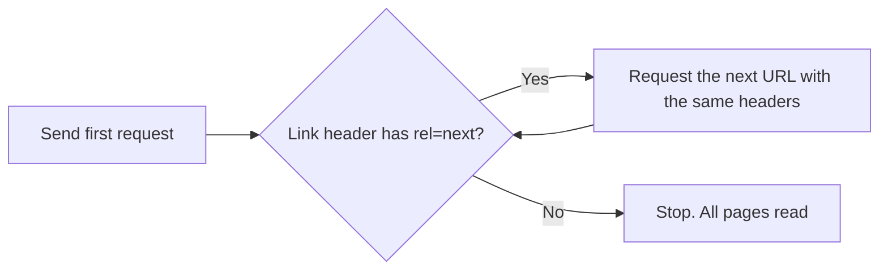

# List repository issues with the GitHub REST API

Use this endpoint to read issues for a repository, such as a documentation backlog report. It does not create or change issues.

**Audience:** Developers and technical writers who work with REST APIs.  
**Base URL:** `https://api.github.com`  
**Method and path:** `GET /repos/{owner}/{repo}/issues`  
**API version used here:** `2022-11-28`, a supported version with an announced support end date of March 10, 2028.  
**Shows:** Parameter tables, nullable fields, pagination, and a status-code recovery table in the shape a developer scans first.

**Problem:** A backlog report needs correct paging, correct filtering, and clear recovery for each failure.

**Approach:** One public endpoint shown end to end, with curl for inspection and short client loops for reuse.

**Validation:** Manual requests against the public `github/docs` repository plus the OpenAPI description in the companion sample.

**Limits:** Read calls only. Write calls are noted separately and were not exercised here.

The [authorship and validation record](../portfolio-evidence/README.md) identifies the writer-owned decisions, AI-assisted work, checks, and limitations for this flagship sample.

## Before you begin

You must install curl before proceeding. The multiline examples below use Bash syntax, so do not paste them unchanged into PowerShell. A PowerShell example appears later in this guide.

You can query the public `github/docs` repository without a token. For a private repository, you must use an approved fine-grained token with access to that repository and read access to Issues. Your organization's policy can impose additional requirements. You must store the token in an approved secret store or session environment variable. Never commit it or include it in a screenshot.

## Send a public request

In this example, you retrieve the first page of open items, ordered by the most recent update. It prints response headers so you can inspect pagination and rate-limit information.

```bash
url="https://api.github.com/repos/github/docs/issues"
url+="?state=open&sort=updated&direction=desc&per_page=30&page=1"
curl --silent --show-error --include \
  --header "Accept: application/vnd.github+json" \
  --header "X-GitHub-Api-Version: 2022-11-28" \
  "$url"
```

Expect HTTP `200` and a JSON array. The public backlog changes, so do not use a specific issue title or count as a success criterion. An empty array, `[]`, is a valid result.

The response can include pull requests. A `pull_request` property identifies those records. Exclude them in your client if the report should contain issues only.

For an authenticated Bash request, add this header after your approved process has populated `GITHUB_TOKEN`:

```bash
--header "Authorization: Bearer $GITHUB_TOKEN"
```

This line is a request option, not a standalone command. Do not send an empty bearer token. If authentication is not needed, omit the header entirely.

<!-- pagebreak -->

## Request parameters

Both path parameters are required. `owner` is the account or organization name. `repo` is the repository name without `.git`. In the example, they are `github` and `docs`. There is no request body.

All query parameters are optional. Omit unused filters.

| Parameter | Type | Values or behavior |
| --- | --- | --- |
| `state` | String | `open` (default), `closed`, or `all`. |
| `milestone` | String | Milestone number, `*` for any, or `none`. |
| `assignee` | String | Username, `*` for any, or `none`. |
| `creator` | String | Username of the issue creator. |
| `mentioned` | String | Username mentioned in the issue. |
| `type` | String | Issue type name, `*` for any, or `none`. |
| `issue_field_values` | String | Comma-separated `field_slug:value` filters, and all must match. Requires enabled, visible issue fields. |
| `labels` | String | Comma-separated label names. |
| `sort` | String | `created` (default), `updated`, or `comments`. |
| `direction` | String | `desc` (default) or `asc`. |
| `since` | String | Updated after this UTC timestamp: `YYYY-MM-DDTHH:MM:SSZ`. |
| `per_page` | Integer | Page size. Default 30, maximum 100. |
| `page` | Integer | Page number. Default 1. |

Issue fields are not available for user-owned repositories. Availability in an organization-owned public repository depends on the organization's settings. Do not assume that an optional feature is enabled merely because the API supports its parameter.

## Encode filter values

Let curl encode spaces and other characters instead of constructing a query string by hand. This example adds a label filter. The repository must contain that exact label, or nothing matches.

```bash
curl --silent --show-error --get \
  --header "Accept: application/vnd.github+json" \
  --header "X-GitHub-Api-Version: 2022-11-28" \
  --data-urlencode "state=open" \
  --data-urlencode "labels=help wanted" \
  --data-urlencode "per_page=30" \
  "https://api.github.com/repos/github/docs/issues"
```

<!-- pagebreak -->

## Read the response

The table lists fields useful for a backlog report, not the full response schema.

| Field | Use in a client |
| --- | --- |
| `number` | Repository-local issue number. Use it with the owner and repository. |
| `id` | API identifier. Not interchangeable with `number`. |
| `title`, `state` | Display text and current state. |
| `html_url` | Browser link for the reader. |
| `updated_at` | Update timestamp for reporting. |
| `labels` | Label objects. The array can be empty. |
| `body` | Markdown description. Can be null. |
| `pull_request` | If present, the record represents a pull request. |

## Send the same request in PowerShell

This example uses no token and makes the same read-only request.

```powershell
$headers = @{
    Accept = "application/vnd.github+json"
    "X-GitHub-Api-Version" = "2022-11-28"
}
$uri = "https://api.github.com/repos/github/docs/issues"
$uri += "?state=open&sort=updated&direction=desc"
$uri += "&per_page=30&page=1"
$items = Invoke-RestMethod -Uri $uri -Headers $headers
$items | Select-Object number, title, state, html_url
```

## Retrieve additional pages

Read the response's `Link` header. If it contains a link with `rel="next"`, request that URL with the same API-version and media-type headers. Continue until no next-page link is present.

The first request uses `--include` to show headers and JSON together for inspection. In an automated client, parse headers separately, because the combined output is not a JSON document. Before attaching credentials to a next-page URL, confirm that it still uses HTTPS and the expected GitHub API host.



For a manual check, the next request can use the same filters with `page=2`. Do not infer that there is only one page because the first response succeeded.

Repository activity can change between requests. Page-based retrieval is not a transactional snapshot. For recurring reports, retain issue identifiers and deduplicate records. Use an overlap when filtering by update time so boundary changes can be reconciled.

<!-- pagebreak -->

## Handle errors

Endpoint-specific responses include `200`, `301`, `404`, and `422`. Authentication, rate limiting, and service availability can produce other responses.

| Status or condition | Recommended handling |
| --- | --- |
| `301` | Inspect the new location. Follow only the intended API host, and update stored repository details if it moved. |
| `401` | Check whether the token is valid. Do not retry repeatedly with the same rejected credential. |
| `403` or `429` | Inspect the response message and rate-limit headers. The cause can be permissions or a rate limit. |
| `404` | Verify the owner, repository, visibility, and token access. A private resource can appear not to exist to an unauthorized client. |
| `422` | Check parameter names and values. Read the response message before retrying. |
| `5xx` | Retry a bounded number of times with increasing delays. Preserve the request identifier for support. |
| Connection failure | Check network access and TLS configuration. Do not disable certificate verification. |

If `Retry-After` is present, wait for that interval. If the primary limit is exhausted, use `X-RateLimit-Reset` to determine when it resets. For a secondary limit without these instructions, wait at least one minute, then increase the delay if the limit persists.

## Follow pagination in code

The shell examples above are for inspection. A report client should parse the `Link` header and keep the same headers on each page. The Python loop below uses only the standard library. It collects issue numbers, skips pull request records when a pure issue list is needed, and deduplicates by `id`.

```python
import json
import time
import urllib.parse
import urllib.request


def parse_link_header(value):
    links = {}
    if not value:
        return links
    for part in value.split(","):
        segments = part.split(";")
        if len(segments) < 2:
            continue
        url = segments[0].strip().strip("<>")
        rel = segments[1].strip()
        if rel.startswith('rel="') and rel.endswith('"'):
            links[rel[5:-1]] = url
    return links


def fetch_all_issues(owner, repo, params, token=None, max_pages=20):
    base = "https://api.github.com/repos/" + owner + "/" + repo + "/issues"
    headers = {
        "Accept": "application/vnd.github+json",
        "X-GitHub-Api-Version": "2022-11-28",
    }
    if token:
        headers["Authorization"] = "Bearer " + token
    seen = {}
    url = base + "?" + urllib.parse.urlencode(params)
    for _ in range(max_pages):
        request = urllib.request.Request(url, headers=headers)
        try:
            with urllib.request.urlopen(request) as response:
                items = json.loads(response.read().decode("utf-8"))
                for item in items:
                    if "pull_request" in item:
                        continue
                    seen[item.get("id")] = item.get("number")
                links = parse_link_header(response.headers.get("Link"))
                next_url = links.get("next")
                if not next_url:
                    break
                parsed = urllib.parse.urlparse(next_url)
                if parsed.scheme != "https":
                    break
                if parsed.hostname != "api.github.com":
                    break
                url = next_url
        except urllib.error.HTTPError as error:
            retry_after = error.headers.get("Retry-After")
            if retry_after:
                time.sleep(int(retry_after))
                continue
            raise
    return seen
```

The same shape in JavaScript with `fetch` in Node 18 and later:

```javascript
async function fetchAllIssues(owner, repo, params, token) {
  const headers = {
    Accept: "application/vnd.github+json",
    "X-GitHub-Api-Version": "2022-11-28",
  };
  if (token) {
    headers.Authorization = "Bearer " + token;
  }
  const seen = new Map();
  let url = "https://api.github.com/repos/" + owner + "/" + repo + "/issues?"
    + new URLSearchParams(params).toString();
  while (url) {
    const response = await fetch(url, { headers });
    if (response.status === 403 || response.status === 429) {
      const retryAfter = response.headers.get("retry-after");
      const waitMs = retryAfter ? Number(retryAfter) * 1000 : 60000;
      await new Promise((resolve) => setTimeout(resolve, waitMs));
      continue;
    }
    if (!response.ok) {
      throw new Error("Request failed with status " + response.status);
    }
    const items = await response.json();
    for (const item of items) {
      if (item.pull_request) {
        continue;
      }
      seen.set(item.id, item.number);
    }
    url = parseNextLink(response.headers.get("link"));
  }
  return seen;
}

function parseNextLink(value) {
  if (!value) {
    return null;
  }
  for (const part of value.split(",")) {
    const match = part.match(/<([^>]+)>;\s*rel="([^"]+)"/);
    if (match && match[2] === "next") {
      const parsed = new URL(match[1]);
      if (parsed.protocol !== "https:") {
        return null;
      }
      if (parsed.hostname !== "api.github.com") {
        return null;
      }
      return match[1];
    }
  }
  return null;
}
```

These loops were checked for syntax in this repository. Live paging behavior changes with repository activity, so test with a small `per_page` value first.

## Handle rate limits in client code

GitHub can return HTTP `403` or `429` when a rate limit is exceeded. The Python and JavaScript examples above inspect `Retry-After` and wait for the requested interval. If that header is absent, they wait for 60 seconds before retrying. Production clients should also inspect `X-RateLimit-Remaining` and `X-RateLimit-Reset`, limit retry attempts, and record enough response metadata to diagnose repeated throttling.

This retry behavior reduces unnecessary traffic. It does not guarantee that a later request succeeds, and it does not prevent every lost or delayed operation. See the GitHub rate-limit guidance in the References section before choosing a retry policy for a production integration.

## Write operations use other endpoints

This sample covers the read endpoint only. Creating an issue uses `POST /repos/{owner}/{repo}/issues` with an auth token and a `title` in the body. It returns `201` with the created issue. Updating uses `PATCH` on a single issue. Both need a test repository and an approved token. The REST reference for issues lists the exact fields. Do not try write calls against a shared backlog.

## Scale notes

- Versioning: the `X-GitHub-Api-Version` header pins behavior. The version used here has a stated support end date in the opening block. Record the header value with any stored sample output.
- Deprecation: if a field or header changes, keep the old sample output labeled with its date and version. Link to the changelog entry from the sample.
- Localization: API field names and error codes stay in English. Any translated guide should keep literals in code format and translate only the surrounding explanation.
- Analytics worth tracking: share of `404` caused by wrong owner or repo names, share of `422` caused by bad filters, and rate limit pauses per report run. Those three point to where the guide needs work.

## Verify a client integration

A focused test should confirm that the client accepts a successful array response, handles `[]`, follows pagination, excludes pull requests when required, and does not assume that nullable fields contain strings.

Test a malformed filter separately from an inaccessible repository. Preserve the HTTP status and safe diagnostic details, but exclude authorization headers from logs.

The machine-readable version of this endpoint is in the [OpenAPI sample](../openapi-reference/README.md).

## References

- [List repository issues and response schema](https://docs.github.com/en/rest/issues/issues#list-repository-issues)
- [Create an issue](https://docs.github.com/en/rest/issues/issues#create-an-issue)
- [Update an issue](https://docs.github.com/en/rest/issues/issues#update-an-issue)
- [Supported API versions](https://docs.github.com/en/rest/about-the-rest-api/api-versions)
- [REST API authentication](https://docs.github.com/en/rest/authentication/authenticating-to-the-rest-api)
- [Pagination](https://docs.github.com/en/rest/using-the-rest-api/using-pagination-in-the-rest-api)
- [Troubleshooting REST API requests](https://docs.github.com/en/rest/using-the-rest-api/troubleshooting-the-rest-api)
