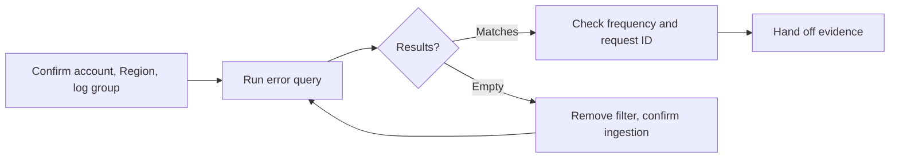

# Investigate application errors in CloudWatch

Use this procedure to collect evidence when an application reports errors but the cause is not yet known.

**Audience:** Support engineers and application operators.  
**Environment:** Amazon CloudWatch Logs Insights QL and an application log group in the Standard log class.  
**Outcome:** A bounded set of log evidence and a handoff that another engineer can reproduce.  
**Shows:** A procedure that stops at what the evidence supports, with a cost warning, scope limits, and an escalation boundary.

**Problem:** A report of errors with no clear cause.

**Approach:** Narrow the account, group, and time window first, then run a small query and hand off what it returns.

**Validation:** The queries follow the linked CloudWatch reference, and each step states what it proves.

**Limits:** Log evidence only. No restart, rollback, or root cause claim.



## Before you begin

Confirm the AWS account, Region, application, and log group with the service owner. You need permission to discover the relevant log groups, start a query, retrieve results, and stop a query. Common IAM actions are `logs:DescribeLogGroups`, `logs:StartQuery`, `logs:GetQueryResults`, and `logs:StopQuery`. The console may need additional read permissions. Ask the administrator to grant the approved role. Do not broaden your own access to resolve a denied request.

Record the incident window and its time zone. This example investigates the sample interval September 18, 2026, 09:00 to 09:15 UTC. Substitute the actual interval from the incident record.

Queries can incur charges based on the data scanned. Select only the relevant groups and a narrow time window. Stop a query if you selected the wrong scope.

## Find recent error messages

1. Open the CloudWatch console in the confirmed account and Region.
2. In the navigation pane, open **Logs Insights**.
3. Select **Logs Insights QL** and the application's log group.
4. Set an absolute time range for the incident. Confirm the time zone shown by the time selector.
5. Enter the following query.
6. Select **Run** and wait for the query to finish.

```text
fields @timestamp, @message, @logStream
| filter @message like /(?i)(error|exception)/
| sort @timestamp desc
| limit 50
```

The result contains up to 50 of the newest matching events within the selected scope. The case-insensitive expression matches text, not a formal severity field. It can match a harmless message that mentions an error, and it can miss failures that use different wording.

Open a result to inspect its fields. Record the timestamp, log stream, exception text, and request or correlation identifier if one is present. Treat customer identifiers, access tokens, and message bodies as potentially sensitive.

An illustrative redacted row looks like this. Values are invented for shape only, with the request identifier matching the example used later in this procedure.

```text
@timestamp: 2026-09-18T09:04:12Z
@logStream: app/prod-3a
@message: [redacted] timeout waiting for upstream [redacted] req-7f31
```

## Interpret the result

An empty result means that this query found no matching events in the selected scope. It does not establish that the application was healthy.

A returned event is evidence of a logged condition, not proof of customer impact or root cause. Check the incident symptoms and the surrounding events before choosing an action. The oldest row among the 50 newest matches is not necessarily the start of the incident.

<!-- pagebreak -->

## Check frequency and surrounding activity

To see whether matching messages cluster in time, replace the query with the following query and keep the same group and interval.

```text
filter @message like /(?i)(error|exception)/
| stats count(*) as matchingEvents by bin(5m)
```

Compare the five-minute buckets with the reported incident window. These are counts of matching log events, not counts of failed requests or affected users. A single request can produce several events.

For a specific request, use a literal substring filter. In this sample, `req-7f31` is an illustrative identifier. Replace it with the identifier from your event.

```text
fields @timestamp, @message, @logStream
| filter strcontains(@message, "req-7f31") = 1
| sort @timestamp asc
| limit 200
```

This query includes surrounding messages only when they contain the same identifier. If 200 rows are returned, narrow the interval or use the service's approved investigation tool before concluding that you have the complete sequence.

## Troubleshoot the investigation

| Observation | Next check |
| --- | --- |
| No matching events | Confirm the account, Region, log group, time zone, and log ingestion. Remove the text filter to check whether any events exist in the interval. |
| Query syntax error | Confirm that the selected language is Logs Insights QL, then compare the query with the sample. |
| Access denied | Capture the denied action and resource without copying credentials. Ask the administrator to check the assigned role. |
| Many matches but no request identifier | Review the application's logging schema. Do not infer that nearby events belong to the same request. |
| The query scans more data than expected | Stop it. Check the selected groups and shorten the interval before running it again. |

## Hand off the evidence

A handoff needs the account, Region, log group, UTC interval, query, completion state, matching timestamps, and a redacted excerpt.

**Illustrative handoff:** The 09:00 to 09:15 UTC query found timeout messages for request `req-7f31`. The log stream and query are attached. The timeout's origin is not yet known, so the service owner needs to compare request metrics and dependency logs.

Escalate if errors continue, evidence suggests customer impact, or the next action requires a configuration change. This procedure does not authorize a restart, rollback, or deletion of logs.

## References

- [Run a CloudWatch Logs Insights query](https://docs.aws.amazon.com/AmazonCloudWatch/latest/logs/CWL_AnalyzeLogData_RunSampleQuery.html)
- [Filter syntax and regular expressions](https://docs.aws.amazon.com/AmazonCloudWatch/latest/logs/CWL_QuerySyntax-Filter.html)
- [Aggregation with stats](https://docs.aws.amazon.com/AmazonCloudWatch/latest/logs/CWL_QuerySyntax-Stats.html)
- [String functions, including strcontains](https://docs.aws.amazon.com/AmazonCloudWatch/latest/logs/CWL_QuerySyntax-operations-functions.html)
- [CloudWatch Logs permissions reference](https://docs.aws.amazon.com/AmazonCloudWatch/latest/logs/permissions-reference-cwl.html)
