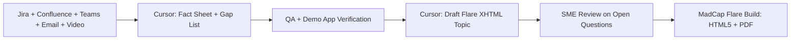

# Accelerate MadCap Flare authoring with Cursor

This training guide shows how a technical writer uses Cursor to author and maintain MadCap Flare documentation when product inputs arrive across Confluence, Jira, Microsoft Teams meetings, emails, demo videos, demo software, and a QA environment.

**Audience:** Technical writers and documentation teams working in MadCap Flare (`Content/**/*.htm`, `.flsnp`, `.fltoc`, `.flvar`).  
**Outcome:** Faster first drafts, fewer post-review UI corrections, preserved Flare XML markup, and a traceable workflow from raw engineering inputs to verified HTML5 and PDF builds.  
**Shows:** Workspace setup, source-triangulation rules, a six-stage workflow, Flare-safe prompts, and quality gates.

## Solve the multi-source authoring bottleneck

In enterprise software and hardware teams, a writer rarely receives a single complete specification. Product truth is scattered across seven places, and they often disagree:

| Input source | What it gives the writer | Common risk if used alone |
| --- | --- | --- |
| Jira epics and bugs | Scope, acceptance criteria, target release, edge cases | Written in developer shorthand with internal component names |
| Confluence specs | Original design intent, architecture diagrams, field tables | Goes stale after implementation changes |
| Teams meeting transcripts | Verbal caveats, why a workflow changed, SME warnings | Conversational tangents and unconfirmed guesses |
| Email threads | Late decisions on limits, permissions, or naming | Buried in reply chains and easy to miss |
| Demo videos | End-to-end task sequence and visual flow | Recorded on an early branch where labels later changed |
| Demo software | Interactive happy-path walkthrough | Mocked data that hides permission or validation errors |
| QA environment | Actual UI labels, menu paths, role behavior, error messages | Can contain unfinished bugs that are not intended behavior |

Cursor solves the synthesis problem when the writer uses it to **compare and structure** those sources rather than asking it to guess product behavior. The writer still verifies UI behavior in QA and builds the final output in MadCap Flare.



<!-- pagebreak -->

## Set up a MadCap Flare project in Cursor

MadCap Flare stores topics as XHTML files (`.htm`), reusable fragments as snippets (`.flsnp`), navigation as XML tables of contents (`.fltoc`), and product terms as variables (`.flvar`). Because these files are plain XML and XHTML, Cursor can read, search, and edit them directly while Flare remains open for visual preview and PDF/HTML5 target builds.

### 1. Exclude generated folders with `.cursorignore`

Flare generates thousands of temporary and output files that pollute search and waste token context. Add a `.cursorignore` file at the Flare project root:

```text
Output/
Analyzer/
FileSync/
Project/Users/
_rels/
*.hem
*.mclog
*.pdf
```

### 2. Add a Flare guardrails rule file

Create `.cursor/rules/madcap-flare.mdc` so every Agent or edit session respects Flare markup and house style automatically. The complete rule file is in [`madcap-flare-rules.mdc`](madcap-flare-rules.mdc). It enforces four non-negotiable rules:

1. **Preserve `MadCap:` namespaces and tags** (`MadCap:xref`, `MadCap:variable`, `MadCap:snippetBlock`, `MadCap:conditions`).
2. **Never touch `Output/`, `Analyzer/`, or `.fltar` targets** unless explicitly asked.
3. **Never invent UI labels, limits, or error strings.** Insert `<!-- TODO SME: ... -->` comments instead.
4. **Follow house style** (third-person role voice, sentence-case headings, bold UI labels, no long dashes or semicolons).

### 3. Connect MCP tools where approved

If your organization permits Model Context Protocol (MCP) connections in Cursor:

- **Atlassian MCP (Jira and Confluence):** Pull epic descriptions, child stories, and spec pages directly into context without manual copy-paste.
- **MarkItDown or file conversion tools:** Convert Word notes, `.vtt` meeting transcripts, or exported `.eml` messages into clean Markdown notes in a local `_scratch/` folder (listed in `.gitignore`).
- **Browser or Snagit tools:** Inspect the QA web application and standardize numbered screenshot callouts.

<!-- pagebreak -->

## Follow the six-stage workflow for every feature

### Stage 1: Run epic-to-TOC gap analysis from Jira and Confluence

Before writing a sentence, pull the Jira epic and the linked Confluence page. Attach the Flare TOC file (`@Project/TOCs/Online-Help.fltoc`) and ask Cursor to map which existing `.htm` topics and `.flsnp` snippets are affected.

**Result:** A scoped checklist of files to edit, reusable variables to reference, and missing requirements to ask about in the next standup.

### Stage 2: Distill Teams meetings, emails, and demo videos into a fact sheet

Never ask AI to write a Flare topic directly from a raw 45-minute meeting transcript or email chain. First, convert the inputs into a single verified fact sheet:

- **Teams meetings:** Export the `.vtt` or `.docx` transcript. Ask Cursor to extract only stated preconditions, role restrictions, and step sequences, along with the speaker and timestamp.
- **Demo videos:** Watch the recording once at 1.5x speed or extract its audio transcript. Log key timestamps (for example, `02:14 - Administrator opens Settings > Users`). Have Cursor turn those observations into ordered steps and flag any step where the presenter skipped a prerequisite.
- **Email threads:** Paste the SME reply chain into the same scratch note so late changes override older assumptions.

### Stage 3: Establish source precedence when inputs conflict

When sources disagree, tell Cursor to apply this hierarchy of truth:

1. **QA environment and demo software** win for exact UI labels, button names, navigation paths, and page layout.
2. **Latest SME email or Jira comment** wins for intended limits, supported configurations, and release scope.
3. **Confluence spec and demo video** provide workflow context and architecture intent.
4. **Unresolved conflicts** become an explicit SME question, never a silent guess.

### Stage 4: Draft the Flare `.htm` topic from an exemplar

Attach one existing, well-formatted Flare topic (`@Content/Topics/Exemplar.htm`), the variable set (`@Project/VariableSets/General.flvar`), and the verified fact sheet. Cursor drafts the new `.htm` file using your project's CSS classes (`div.steps`, `p.note`, `p.figure-caption`) and `MadCap:` tags:

```xml
<?xml version="1.0" encoding="utf-8"?>
<html xmlns:MadCap="http://www.madcapsoftware.com/Schemas/MadCap.xsd">
    <head>
        <title>Configure alarm notifications</title>
    </head>
    <body>
        <h1>Configure alarm notifications</h1>
        <p>The administrator configures notification channels in
        <MadCap:variable name="General.ProductName" /> so site personnel
        receive alerts when a threshold is exceeded.</p>
        <MadCap:snippetBlock src="../Resources/Snippets/AdminRoleNote.flsnp" />
        <h2>Assign a notification channel</h2>
        <ol>
            <li>Select <b>Settings</b> &gt; <b>Notifications</b>.</li>
            <li>Select <b>Add channel</b> and choose the site scope.</li>
            <li>Select <b>Save</b>.</li>
        </ol>
        <p>The <b>Notifications</b> page displays the active channel. For
        escalation rules, see
        <MadCap:xref href="EscalationRules.htm">Escalation rules</MadCap:xref>.
        </p>
    </body>
</html>
```

### Stage 5: Verify against the QA environment and capture screenshots

Open the drafted topic alongside the live QA environment:

1. Walk through every numbered step in the QA application using a test account with the target role (such as operator or administrator), not a developer superuser account.
2. Paste any mismatched field names, error banners, or permission differences into Cursor (`Prompt 4` in [`multi-source-prompts.md`](multi-source-prompts.md)) to update the `.htm` file.
3. Capture screenshots from QA using realistic demo data, add numbered callouts in Local Callout Studio or Snagit, save the images under `Content/Resources/Images/`, and place `p.figure-caption` immediately after the image.

### Stage 6: Run automated quality checks before SME review and Flare build

Before sending the draft to an engineer or product manager:

1. Ask Cursor to run a style and markup audit against `.cursor/rules/madcap-flare.mdc` (checking for accidental `you`/`your`, long dashes, semicolons, unclosed XML tags, or missing `MadCap:xref` targets).
2. Send the SME a short, numbered list of the `<!-- TODO SME -->` questions rather than asking them to hunt for errors across a 20-page PDF.
3. Resolve the SME answers, build the HTML5 and PDF targets in MadCap Flare, and inspect the output in the Flare viewer.

## Measure workflow impact

This portfolio does not include a controlled productivity study. Teams adopting the workflow should establish a baseline and measure the same activities before and after adoption.

| Activity | Measure | Quality check |
| --- | --- | --- |
| Gap analysis across Jira, Confluence, and the TOC | Time from source collection to an approved impact list | Number of affected topics or reusable assets missed during review |
| Turning meeting, video, and email notes into a draft | Drafting time after the fact sheet is approved | Percentage of claims linked to a source or recorded as an SME question |
| Applying Flare variables, snippets, and cross-references | Manual correction time after the first build | Broken references, invalid XML, and missed reuse opportunities |
| QA label reconciliation and style review | Verification time per changed topic | UI-label corrections and style findings found after SME review |
| Preparing release notes from Jira issues | Time from approved issue set to reviewed notes | Internal IDs, unsupported claims, or missing customer impact found in review |

Record the number and complexity of topics, the reviewer, the model and tool configuration, and the verification effort. Without that context, time comparisons can imply precision that the evidence does not support.

## Guardrails that protect documentation quality

- **Never let AI edit `Output/` or `.fltar` files.** Build artifacts belong to the MadCap Flare compiler.
- **Never skip the exemplar topic.** Flare projects rely on specific stylesheet classes (`p.note`, `div.image-callout`, `MadCap:xref class="Section"`). Attaching one existing `.htm` topic prevents generic HTML output.
- **Keep raw transcripts and emails out of the Git repository.** Store meeting transcripts, `.eml` files, and scratch fact sheets in an ignored `_scratch/` folder. Commit only the clean `.htm`, `.flsnp`, and image files.
- **Verify in Flare's XML Editor before building.** After Cursor edits an `.htm` file, open it in MadCap Flare to confirm that snippets, variables, and condition tags render without warnings.

## Companion files in this sample

- [`Cursor-MadCap-Flare-Training-Guide.pdf`](Cursor-MadCap-Flare-Training-Guide.pdf): Standalone printable PDF containing this workflow guide, the prompt playbook, and the Flare rule file.
- [`madcap-flare-rules.mdc`](madcap-flare-rules.mdc): Drop-in Cursor rule file for MadCap Flare projects.
- [`multi-source-prompts.md`](multi-source-prompts.md): Five copy-pasteable prompts for Jira/Confluence gap analysis, transcript/video/email extraction, Flare `.htm` drafting, QA reconciliation, and release notes.
