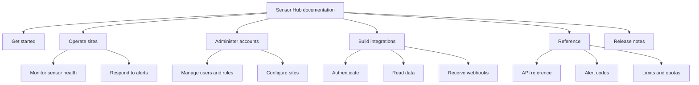

# Design the information architecture for a documentation set

A design exercise for a fictional product, **Sensor Hub**, a cloud service that collects readings from field sensors and raises alerts. The exercise produces the planning artifacts a documentation architect owns: a content model, a taxonomy, a navigation structure, reuse rules, and a governance plan.

**Audience:** Documentation managers and architects.  
**Shows:** How structure decisions follow from who reads the docs and what they are trying to do, and how those decisions stay enforceable.  
**Note:** Sensor Hub is invented for this exercise. No real product, customer, or metrics are described.

## Readers and their jobs

| Reader | Main job | Typical question |
| --- | --- | --- |
| Site operator | Keep sensors reporting | "Why has this sensor gone quiet?" |
| Administrator | Manage users, sites, and access | "How do I give a contractor read-only access?" |
| Integration developer | Pull readings into another system | "How do I page through readings?" |
| Support engineer | Diagnose a customer problem | "What does this alert code mean?" |

## Navigation structure

Top-level sections follow the reader's job, not the product's internal components. A support engineer and an operator both need alert codes, so the codes live in one reference topic that both paths link to. Two topics from this map are written in full in the portfolio: [Configure role-based access control for site users](../rbac-administration/README.md) under **Manage users and roles**, and [Event-driven Pub/Sub architecture with gRPC](../grpc-architecture/README.md) under **Build integrations**.

## Content model

[`content-model.yaml`](content-model.yaml) defines each topic type, what it must contain, and what it must not contain.

| Type | Answers | Must contain | Must not contain |
| --- | --- | --- | --- |
| Concept | What is it and why does it matter? | Definition, how it fits with related ideas | Numbered steps |
| Task | How do I do this? | Purpose, prerequisites if any, numbered steps, expected result | Background explanation longer than a short paragraph |
| Reference | What are the exact values? | Tables or lists, complete and scannable | Procedures |
| Troubleshooting | What went wrong and what do I check? | Symptom, likely cause, next check | Guesses presented as causes |
| Release note | What changed for me? | Change, reader impact, action needed | Internal ticket identifiers |

## Taxonomy and metadata

[`taxonomy.yaml`](taxonomy.yaml) lists the controlled values for product area, audience, and task type, and maps reader wording to official terms. The metadata fields reuse the [schema from the AI-ready content sample](../ai-ready-content/metadata-schema.yaml), so search filters and retrieval systems read the same facts.

Synonyms matter. A reader types "offline" where the product says "no data". The taxonomy records that mapping once, and search uses it.

## Reuse rules

| Content | Rule | Why |
| --- | --- | --- |
| Product and feature names | Defined once as keys and referenced everywhere | A rename changes one line |
| Warnings | Stored as reusable snippets with one owner | The same hazard never reads two ways |
| Limits and quotas | One reference topic. Other topics link, not copy | A number copied in five places is wrong in three |
| Shared prerequisites | A snippet included in each task that needs it | Steps stay current without hunting |
| Version differences | Conditional text with a clear tag, reviewed each release | Stale variants are the main source of wrong answers |

## Governance

| Decision | Owner | Reviewed |
| --- | --- | --- |
| Topic types and required sections | Documentation lead | Each year |
| Taxonomy values and synonyms | Documentation lead with support | Each release |
| Technical accuracy of a topic | Engineering reviewer | Each change |
| Style and terminology | Writer, checked against the [style checklist](../ai-workflows/style-checklist.md) | Each change |
| Stale content | Topic owner, from the `last_reviewed` field | Quarterly report |

A topic with no owner or no review date fails the publishing check. This rule keeps the structure from decaying.

## Scale notes

This exercise assumes one current release. At larger scale the same rules need version handling. Keep one reference topic per release for limits and alert codes, and link from tasks instead of copying values. Tag conditional text with the release it applies to, and review open conditions each release so stale variants do not linger.

For translation, the taxonomy carries the burden. Controlled values and recorded synonyms keep source terms steady, which keeps translation memory matches high. Freeze UI labels and codes in code format and translate only the surrounding explanation.

For deprecation, a changed limit or renamed alert code needs a dated note in the reference topic plus a link from affected tasks. Keep the old value labeled with its end date until no supported release uses it.

## Success measures to track

I have no data for a fictional product, so none is claimed. These are the measures this design would be judged by:

- Share of support questions answerable from existing topics
- Searches that return no result, and what people typed
- Time from a product change to an updated topic
- Share of topics past their review date
- Retrieval test results, using the hand-run method in the [AI-ready content sample](../ai-ready-content/README.md)
