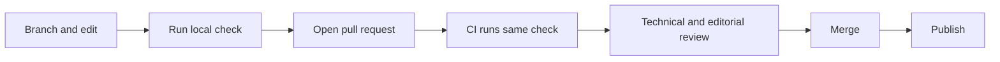

# Review and validate a documentation change

This guide uses the portfolio repository as a docs-as-code example. The source, an automated check, and a pull-request workflow are included. No private repository or publishing service is required to run the local check.

**Audience:** Technical writers and engineers reviewing documentation.  
**Prerequisites:** A local copy of this repository, Python 3.12 or later, and Git if you use the branch workflow.  
**Note:** The check script was written with developer and AI assistance. My part is deciding what to check, reading the results, and acting on failures.  
**Outcome:** A focused change with a reproducible validation result and clear review responsibilities.

## Run the repository check

From the repository root, run:

```text
python tools/check_portfolio.py
```

On Windows, `py -3.12` can replace `python` if the Python launcher is installed. On a system where the command is `python3`, use that command instead.

The script returns exit code 0 when its checks pass and exit code 1 when it finds a problem. Read the reported file and issue, correct the source, and run it again. Do not suppress a failing check merely to make the workflow pass.

The custom check script uses the Python standard library to verify local Markdown file links, heading structure, closed code fences, the syntax of Python and XML examples, DITA references and keys, and migration tests. 

**Scaling this pattern:** While this portfolio uses a custom Python script for portability, enterprise environments scale this docs-as-code validation by adopting industry-standard linters. For example, you can integrate **Vale** to enforce the corporate style guide (prose linting) and **Markdownlint** to enforce Markdown structural consistency across hundreds of repositories.

It does not assess grammar, technical truth, external URL availability, PDF appearance, DITA schema validity, or live product behavior. Those require separate review.



## Keep the change focused

1. Identify the affected task, audience, and product behavior.
2. Create a working branch in your own repository or fork.
3. Update the source topic and any directly affected examples or references.
4. Run the local check and inspect the diff for unrelated changes.
5. Open a pull request that describes the reader impact, evidence, and validation limits.
6. Resolve the technical and editorial reviews before merging under the repository's rules.

A change that updates a command should also update its expected result and failure path. A change that only corrects punctuation should not silently alter product behavior.

## Assign review responsibilities

| Reviewer | Review focus |
| --- | --- |
| Writer | Audience, task sequence, terminology, links, and readability. |
| Technical reviewer | Command behavior, prerequisites, permissions, and expected results. |
| Release owner | Product version, release timing, scope, and approval to publish. |
| Publisher | Output build, navigation, code formatting, and final delivery files. |

One person can hold more than one role in a small team, but the review record should still identify which checks were performed.

<!-- pagebreak -->

## Automated pull-request check

The repository includes [docs-check.yml](../../.github/workflows/docs-check.yml). It runs for pull requests and manual dispatches. The job needs no repository write permission and no application secrets.

```yaml
name: Check portfolio
on:
  pull_request:
  workflow_dispatch:
permissions:
  contents: read
jobs:
  check:
    runs-on: ubuntu-latest
    timeout-minutes: 5
    steps:
      - uses: actions/checkout@v6
      - uses: actions/setup-python@v6
        with:
          python-version: "3.12"
      - name: Check sources and examples
        run: python tools/check_portfolio.py
```

This sample uses major-version action tags. Production repositories can pin reviewed commit hashes under their supply-chain policy.

Required checks must be enabled separately in repository rules. This portfolio includes the workflow, not a hosted run or configured branch protection.

## Completed change-review example

The following is a sample review record for the Kubernetes procedure in this portfolio, not a record of approval from an employer.

**Change:** Bound the rollout wait and make the target namespace explicit.

**Reader impact:** The original command relied on the active namespace and could wait without a defined timeout. The revised command targets the sample's `default` namespace and waits for up to 120 seconds.

**Documentation decision:** Keep context verification before the rollout command. Explain that a timeout does not roll back the deployment. Put the application smoke test after the successful rollout result.

**Evidence:** The kubectl command reference defines the timeout and revision behavior. The deployment reference distinguishes rollout completion from application-level checks. Both sources are linked in the structured-authoring sample.

**Validation scope:** Compare the Markdown command with the DITA task, run the repository check, and inspect the PDF code block. Cluster execution remains outside this local check.

**Publication gate:** A technical reviewer must verify the procedure in the target environment before it becomes operational documentation. No production approval is implied by this portfolio record.

## Recover from a documentation regression

If a merged change is wrong, open a corrective change that identifies the affected version and restores accurate instructions. If an earlier revision is known to be correct, revert the relevant documentation commit through the normal review process. Rebuild and inspect every affected output.

Add a test or review item for the missed condition where it can prevent recurrence.

## References

- [GitHub Actions workflow syntax](https://docs.github.com/en/actions/reference/workflows-and-actions/workflow-syntax)
- [Python setup action](https://github.com/actions/setup-python)
- [Checkout action](https://github.com/actions/checkout)
