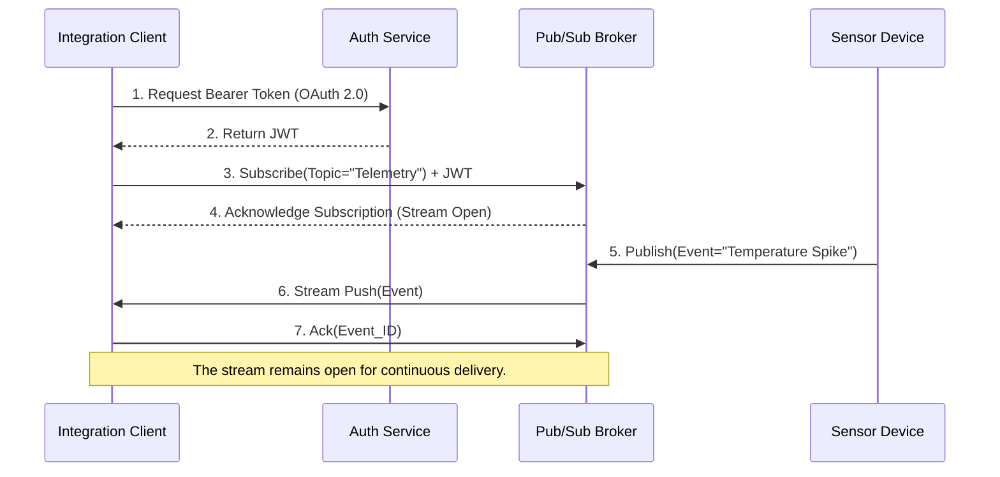

# Event-driven Pub/Sub architecture with gRPC

This concept document explains the architecture of the fictitious **Sensor Hub Event Stream**, which uses an event-driven Pub/Sub model over gRPC and Protocol Buffers (Protobufs).

**Audience:** Software engineers and integration developers building microservices that react to Sensor Hub alerts.  
**Outcome:** A clear mental model of how the fictional design streams telemetry, authenticates consumers, and handles acknowledgement and redelivery.

**Shows:** Mermaid sequence diagrams, Protobuf service definitions, and explanations of distributed system concepts designed for a technical audience.

## Publish-subscribe architecture

Sensor Hub uses a publish-subscribe (Pub/Sub) pattern to distribute sensor telemetry to connected clients. Instead of repeated REST polling, the fictional design streams events over HTTP/2 and gRPC.

When you subscribe to a Sensor Hub topic, you establish a long-lived server-streaming gRPC connection.

1. **Protocol Buffers (Protobuf):** Data is serialized into compact binary payloads, reducing bandwidth usage compared to JSON.
2. **HTTP/2 streaming:** The connection remains open, allowing the server to push new events to your client as they arrive.
3. **Dead-letter queues (DLQ):** If your client fails to acknowledge an event within the retry window, the event is routed to a DLQ for inspection or later reprocessing.

These delivery rules are design assumptions for the fictional sample. They are not measured scale results or guarantees from a deployed service. A production specification would need to define throughput, retention, retry limits, ordering, duplicate delivery, and failure behavior before an integration guide could make stronger claims.

## Streaming data flow

The following sequence illustrates the handshake and data flow when a client subscribes to the `Telemetry` topic. 



## Protobuf service definition

To interact with the Pub/Sub broker, generate client stubs from the `.proto` definition. The service contract defines both the subscription method and the message shapes.

```protobuf
syntax = "proto3";

package sensorhub.events.v1;

option go_package = "github.com/sensorhub/api/events/v1";

// The EventService streams real-time telemetry from registered sensors.
service EventService {
  // Subscribe opens a server-streaming RPC to receive events as they occur.
  rpc Subscribe(SubscribeRequest) returns (stream SensorEvent) {}
  
  // Acknowledge confirms receipt of an event to prevent redelivery.
  rpc Acknowledge(AckRequest) returns (AckResponse) {}
}

message SubscribeRequest {
  // The topic to subscribe to (e.g., "projects/my-project/topics/telemetry").
  string topic = 1;
}

message SensorEvent {
  // Unique identifier for the event.
  string event_id = 1;
  // The identifier of the sensor that generated the event.
  string sensor_id = 2;
  // The telemetry payload, serialized as a JSON string for flexibility.
  string payload = 3;
  // Unix timestamp of when the event occurred.
  int64 timestamp = 4;
}

message AckRequest {
  string event_id = 1;
}

message AckResponse {
  bool success = 1;
}
```

### Why server-streaming RPC?

In the `EventService` definition, the `Subscribe` method returns `stream SensorEvent`. The `stream` keyword indicates a server-streaming RPC. You send a single `SubscribeRequest`, and the server sends back a sequence of `SensorEvent` messages. Your client reads from the returned stream until the server closes the connection or the client disconnects. 

## Integration practices

When you implement the gRPC client, follow these practices:

- **Implement exponential backoff:** If the stream disconnects unexpectedly, your client should reconnect using exponential backoff (for example, 1s, 2s, 4s, 8s) to avoid overwhelming the broker during a brief outage.
- **Acknowledge every message:** The broker tracks unacknowledged messages. If you fail to call `Acknowledge` within the topic's timeout window, the broker redelivers the event.
- **Enforce TLS:** Ensure your client enforces TLS. Sensor Hub rejects insecure gRPC connections. Pass your OAuth 2.0 JWT in the gRPC metadata (the equivalent of HTTP headers).