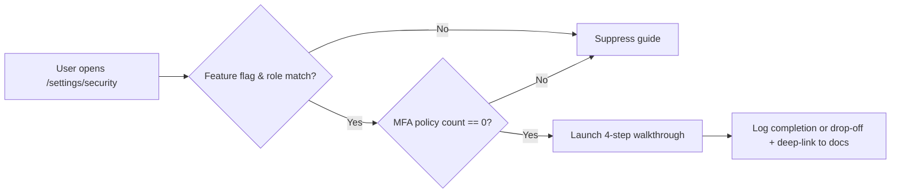

# Design and target in-app onboarding and release announcements

In-app walkthroughs, tooltips, and release banners help administrators complete high-stakes tasks inside the product console, but untargeted pop-ups train users to close every message without reading it. This sample defines a role-targeted onboarding tour, a release announcement banner, UX microcopy budgets, and completion metrics for the fictional **Sensor Hub** administration console.

**Audience:** Technical writers, UX writers, and product teams building in-app guidance in platforms such as Pendo, WalkMe, Appcues, or Shepherd.js.  
**Product:** Sensor Hub administration console (shared with the [information architecture](../doc-architecture/README.md) and [RBAC administration](../rbac-administration/README.md) samples).  
**Outcome:** A targeted 4-step conditional MFA walkthrough, a non-blocking release banner, a portable JSON specification, and automated copy-budget checks.  
**Shows:** Segment targeting by role and feature flag, resilient DOM selectors, concise UX microcopy, deep-links to full documentation, and analytics thresholds.



## Choose the right surface for the user's job

In-app guidance complements reference documentation instead of pasting a manual into a tooltip. Each surface handles one moment in the user workflow.

| Surface | When to use it | When to use full documentation instead |
| --- | --- | --- |
| Multi-step walkthrough (3 to 5 steps) | First-time setup where sequence prevents lockouts, such as scoping conditional MFA before enforcing it. | Edge-case prerequisites, IdP XML certificates, recovery procedures, and compliance matrices. |
| Contextual tooltip | Clarifying one non-obvious field, such as how UTC expiration dates affect active API tokens. | Multi-role permission comparisons that require a table. |
| Non-blocking release banner | Announcing a new capability on the exact page where the user can adopt it, such as site-scoped API keys. | Full version history, breaking changes, and API payload diffs. |

## Enforce UX writing and targeting guardrails

Every guide in [`onboarding-tour.json`](onboarding-tour.json) is checked against five rules in [`test_onboarding_spec.py`](test_onboarding_spec.py):

1. **Gate on role, state, and feature flag.** The MFA tour runs only when `requiredRole` is `organization_administrator`, the `conditional_mfa_v2` flag is active, and `mfa_policy_count` equals `0`. Read-only auditors and configured tenants never see the prompt.
2. **Anchor on stable attributes.** Steps bind to `[data-tour-id='...']` attributes agreed with front-end engineering rather than generated CSS class names that break during UI refactors.
3. **Keep microcopy scannable.** Step titles stay within 52 characters and start with an action verb. Step bodies stay within 150 characters and explain both the action and why the choice is safe.
4. **Always allow exit or snooze.** Every walkthrough step and release banner sets `"dismissible": true` and caps total impressions so an interrupted administrator is never trapped by a modal overlay.
5. **Pair every guide with a deep link.** Each step includes a `docsPath` anchor so administrators who need deeper policy rules can open the exact heading in the help portal.

## Portable JSON guide specification

Teams using code-based libraries such as Shepherd.js consume JSON definitions directly, while no-code platforms such as Pendo or WalkMe mirror the same targeting properties, DOM selectors, copy blocks, and event hooks during authoring and QA review.

Wait-free automated validation runs locally and in CI alongside the rest of the repository checks. Below is the complete [`onboarding-tour.json`](onboarding-tour.json) specification:

```json
{
  "schemaVersion": "1.0",
  "product": "Sensor Hub Administration Console",
  "guides": [
    {
      "guideId": "admin-mfa-policy-onboarding-v2",
      "type": "walkthrough",
      "releaseFlag": "conditional_mfa_v2",
      "targeting": {
        "requiredRole": "organization_administrator",
        "urlRoute": "/settings/security",
        "conditions": [
          { "property": "mfa_policy_count", "operator": "equals", "value": 0 },
          { "property": "account_age_days", "operator": "less_than_or_equal", "value": 30 }
        ],
        "cooldownHoursAfterSnooze": 72,
        "maxImpressions": 2
      },
      "telemetry": {
        "impressionEvent": "guide_viewed",
        "stepAdvanceEvent": "guide_step_completed",
        "completionEvent": "guide_completed",
        "dismissEvent": "guide_dismissed",
        "docsClickEvent": "guide_docs_opened"
      },
      "steps": [
        {
          "stepId": "open-create-policy",
          "stepNumber": 1,
          "selector": "[data-tour-id='security-create-mfa-policy']",
          "placement": "bottom",
          "advanceOn": "click",
          "dismissible": true,
          "title": "Require MFA for privileged roles",
          "body": "Create a conditional MFA policy so organization and site administrators verify identity at sign-in.",
          "primaryCta": "Next",
          "secondaryCta": "Snooze for 3 days",
          "docsPath": "/docs/security/configure-conditional-mfa#before-you-begin"
        },
        {
          "stepId": "select-target-roles",
          "stepNumber": 2,
          "selector": "[data-tour-id='mfa-role-scope-picker']",
          "placement": "right",
          "advanceOn": "button",
          "dismissible": true,
          "title": "Scope the policy to admin roles first",
          "body": "Start with Organization administrator and Integration developer to protect API keys without disrupting read-only auditors.",
          "primaryCta": "Next",
          "secondaryCta": "Dismiss",
          "docsPath": "/docs/security/configure-conditional-mfa#scope-by-role"
        },
        {
          "stepId": "choose-authenticator-factors",
          "stepNumber": 3,
          "selector": "[data-tour-id='mfa-factor-checkboxes']",
          "placement": "right",
          "advanceOn": "button",
          "dismissible": true,
          "title": "Allow phishing-resistant factors",
          "body": "Enable WebAuthn passkeys and authenticator apps. Keep recovery codes restricted to verified help-desk resets.",
          "primaryCta": "Next",
          "secondaryCta": "Dismiss",
          "docsPath": "/docs/security/configure-conditional-mfa#supported-factors"
        },
        {
          "stepId": "set-grace-period-and-activate",
          "stepNumber": 4,
          "selector": "[data-tour-id='mfa-enforcement-save']",
          "placement": "top",
          "advanceOn": "button",
          "dismissible": true,
          "title": "Set an enrollment window and activate",
          "body": "A 7-day enrollment period lets current administrators register a factor before strict sign-in enforcement begins.",
          "primaryCta": "Done",
          "secondaryCta": "Open full guide",
          "docsPath": "/docs/security/configure-conditional-mfa#verify-enforcement-in-audit-log"
        }
      ]
    },
    {
      "guideId": "release-2-4-scoped-api-keys-banner",
      "type": "banner",
      "releaseFlag": "site_scoped_api_keys_2_4",
      "targeting": {
        "requiredRole": "integration_developer",
        "urlRoute": "/settings/api-credentials",
        "conditions": [
          { "property": "unscoped_key_count", "operator": "greater_than", "value": 0 }
        ],
        "cooldownHoursAfterSnooze": 168,
        "maxImpressions": 1
      },
      "telemetry": {
        "impressionEvent": "banner_viewed",
        "completionEvent": "banner_cta_clicked",
        "dismissEvent": "banner_dismissed",
        "docsClickEvent": "banner_release_notes_opened"
      },
      "announcement": {
        "dismissible": true,
        "title": "New in 2.4: Restrict API keys to specific sites",
        "body": "Replace organization-wide tokens with site-scoped keys without rotating active webhook secrets.",
        "primaryCta": "Review migration steps",
        "docsPath": "/docs/releases/2-4#site-scoped-api-keys"
      }
    }
  ]
}
```

## Measure guide completion and iterate

Shipping an in-app guide is the start of the feedback loop. Product analytics and documentation telemetry show whether the microcopy helps or gets in the way.

| Signal in guide analytics | Likely root cause | Content or targeting fix |
| --- | --- | --- |
| High Step 1 dismissal rate (above 60%) | Trigger fires before the administrator is ready to configure MFA, or segment includes non-security admins. | Trigger on click of **Security policies** or narrow the segment to accounts that have already added at least one site. |
| Sharp drop-off at a middle step | Target UI element sits inside a collapsed drawer, or the step asks for information the user must fetch elsewhere. | Check DOM visibility before advancing and state prerequisites in Step 1. |
| High `guide_docs_opened` clicks on one step | The UI decision carries policy risk that a 150-character tooltip cannot resolve, such as grace-period lockout behavior. | Keep the deep link prominent and add a concise callout table at the target documentation anchor. |
| Guide completed, but `mfa_policy_count` stays `0` | Users click **Next** through button-driven steps without saving the policy form. | Change Step 1 and Step 4 to event-driven progression tied to the UI action. |
