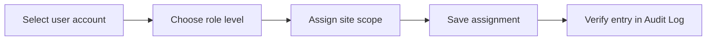

# Configure role-based access control for site users

Sensor Hub uses role-based access control (RBAC) to restrict site data, alert configuration, and account administration to authorized personnel. Organization administrators assign roles at the organization or site level, enabling least-privilege access for operators, environmental health and safety (EHS) personnel, integration developers, and external auditors.

**Audience:** Organization administrators and security administrators.  
**Product:** Sensor Hub administration console (fictional product from the [information architecture sample](../doc-architecture/README.md)).  
**Outcome:** A user account with scoped site permissions and a verified audit-log entry.  
**Shows:** Enterprise administrator documentation written in third-person role-based voice (no second-person pronouns), a role-permission matrix, least-privilege guardrails, and an audit verification step.

**Note:** This topic applies only to the Sensor Hub administration console. Site monitoring and alert response procedures appear in the Site Operator Guide.

## Role permissions matrix

Each predefined role grants a fixed set of permissions. Assigning a site-level role restricts those permissions to the selected sites.

| Capability | Auditor (read-only) | Site operator | Integration developer | Organization administrator |
| --- | --- | --- | --- | --- |
| View live sensor readings and alert history | Allowed | Allowed | Allowed (API and console) | Allowed |
| Acknowledge alerts and add investigation notes | Not allowed | Allowed | Not allowed | Allowed |
| Edit alert thresholds and site schedules | Not allowed | Allowed for assigned sites | Not allowed | Allowed |
| Create and rotate API keys and webhooks | Not allowed | Not allowed | Allowed for assigned sites | Allowed |
| Invite users, assign roles, and view audit logs | Not allowed | Not allowed | Not allowed | Allowed |

**Note:** Custom roles are not supported in the standard tier. When a user holds multiple site assignments, Sensor Hub applies the permissions configured for each individual site without granting access to unassigned sites.

## Prerequisites

- **Administrator access:** The administrator account must hold the **Organization administrator** role.
- **Verified user account:** The target user must exist in **Settings** > **Users and roles** with a **Verified** account status.
- **Approved access request:** The access request must specify the target role, the site names, and the access expiration date for temporary contractors.

**Warning:** Granting the **Organization administrator** role provides unrestricted access to all sites, user accounts, and API credentials across the organization. Assign **Auditor** or **Site operator** when the user only needs to view readings or manage alerts at specific sites.

<!-- pagebreak -->

## Assign a scoped role to a user

The organization administrator assigns or updates a user's role from the administration console:

1. Sign in to the Sensor Hub administration console with an **Organization administrator** account.
2. In the navigation pane, select **Settings** > **Users and roles**.
3. On the **Users and roles** page, locate the user account by email address and select **Manage access**.
4. In the **Role** list, select the required role, such as **Auditor** or **Site operator**.
5. Under **Site scope**, select **Selected sites only**, then select each site listed in the approved access request.
6. (Optional) For a contractor or temporary reviewer, select **Set expiration date** and enter the final date of access in `YYYY-MM-DD` format.
7. Select **Save changes**.

The **Users and roles** page displays the updated role and site count next to the user's name. Active sessions for that user apply the new permission set within 60 seconds without requiring the user to sign out.

**Note:** Sensor Hub prevents an administrator from removing the **Organization administrator** role from their own account. This restriction ensures that at least one active administrator remains in the organization.

## Verify the role assignment in the audit log

After changing permissions, the administrator confirms that the change is recorded in the organization audit log:

1. In the navigation pane, select **Settings** > **Audit log**.
2. In the **Event type** filter, select **Role assignment updated**.
3. Confirm that the newest entry displays the administrator's email address as the actor, the target user's email address, the assigned role, and the list of scoped sites.
4. Copy the **Audit event ID** into the access request ticket for compliance records.

## Revoke site access or downgrade a role

When a user changes teams or a contractor engagement ends early, the administrator removes site access from **Settings** > **Users and roles**:

1. Select **Manage access** next to the user account.
2. Clear the removed sites under **Site scope**, or select **Revoke all access** to disable console and API access immediately.
3. Select **Save changes**.

Revoking all access invalidates active web sessions for that user and disables personal API tokens created by that account. Shared service webhooks remain active under the site's integration identity.

## Troubleshoot role and access issues

The following table lists common access symptoms and the corresponding administrative checks.

| Symptom | Cause | Administrative action |
| --- | --- | --- |
| The **Manage access** button is dimmed | The signed-in account does not hold the **Organization administrator** role, or the row belongs to the signed-in administrator. | Sign in with a separate **Organization administrator** account to modify the role. |
| A user signs in but the **Sites** page displays `No sites assigned` | The user holds a site-scoped role (**Auditor** or **Site operator**) with no sites selected under **Site scope**. | Open **Settings** > **Users and roles**, select **Manage access** for the user, and select at least one site. |
| A contractor loses access before the project ends | The date in **Set expiration date** has passed in UTC. | Verify whether an extension is approved, then update the expiration date and record the new **Audit event ID**. |
| An integration developer cannot view **Settings** > **Users and roles** | The **Integration developer** role grants API key and webhook management only, not user administration. | Keep the user on **Integration developer**. User management requires an **Organization administrator**. |
