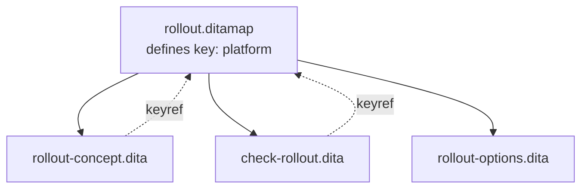

# Check a Kubernetes deployment rollout

This sample combines an operations procedure with its DITA source. The procedure is intended for an operator checking a release. The source shows how the same content can be organized for structured publishing.

**Problem:** An operator needs a read-only check with a clear stop line.

**Approach:** Verify context first, wait with a bounded timeout, then investigate without changing the workload.

**Validation:** Commands follow the linked kubectl reference.

**Limits:** Deployment status only. Application health needs the service smoke test noted at the end.

## Before you begin

Install a kubectl version supported by your cluster, obtain the approved cluster configuration, and confirm the release's cluster context, namespace, deployment name, and revision. You need read access, including get and watch access to deployments. Investigation commands can require additional permissions.

The examples use an existing deployment named `nginx` in the `default` namespace. These are sample resource names, not instructions to create a deployment. Change them only to the values in your release record.

The commands are single-line commands that work in Bash and PowerShell.

## Check the deployment

1. Run `kubectl config current-context`. Compare the result with the release record. Stop if the context is wrong.
2. Run the following command to wait up to two minutes.

```text
kubectl rollout status deployment/nginx --namespace=default --timeout=120s
```

On success, kubectl reports that the deployment successfully rolled out. Record the command, output, context, namespace, and time in the release record. Then run the service's approved application smoke test. Deployment completion alone does not verify a user transaction.

By default, the command follows the latest rollout. If another rollout starts, the command can switch to it. If the release record specifies revision 3, add `--revision=3`. Do not copy that revision number without checking it.

## Investigate an incomplete rollout

A timeout stops this wait. It does not undo the deployment. Capture the output before retrying. If your permissions allow it, inspect the deployment:

```text
kubectl describe deployment nginx --namespace=default
```

Review its conditions and events with the release owner. Do not publish full configuration output if it includes sensitive values.

| Observation | Next action |
| --- | --- |
| Deployment not found | Confirm the cluster context, namespace, and deployment name. |
| Forbidden response | Ask the administrator to check read permissions for the intended resource. |
| Timeout | Check deployment conditions and recent events. Confirm that the timeout suits the release before waiting again. |
| Another revision superseded the selected one | Reconcile the active rollout with the release record. Do not report success for the wrong revision. |
| Successful rollout but failed application test | Keep the release under investigation. Share the application result with the service owner. |

Do not restart workloads or run `kubectl rollout undo` as part of this read-only check. Those actions require the release team's change or recovery procedure.

<!-- pagebreak -->

## Organize the source for reuse

The [source map](source/rollout.ditamap) assembles three independently maintained topics:

| Topic | Reader question | Source |
| --- | --- | --- |
| Concept | What does the check establish? | [rollout-concept.dita](source/rollout-concept.dita) |
| Task | How do I check the deployment? | [check-rollout.dita](source/check-rollout.dita) |
| Reference | What do the options mean? | [rollout-options.dita](source/rollout-options.dita) |

The concept explains the boundary between deployment status and application behavior. The task contains prerequisites, actions, an expected result, and a follow-up. The reference holds option definitions that can be linked from another procedure.

The map defines the `platform` key once. The concept and task use `<keyword keyref="platform"/>`, so the product term is resolved in the map context. This is a small, inspectable reuse example, not a claim that the Kubernetes procedure can be republished unchanged for another platform.



### Map source

```xml
<?xml version="1.0" encoding="UTF-8"?>
<!DOCTYPE map PUBLIC "-//OASIS//DTD DITA Map//EN" "map.dtd">
<map id="rollout-guide" xml:lang="en-US">
  <title>Deployment rollout checks</title>
  <keydef keys="platform">
    <topicmeta>
      <keywords><keyword>Kubernetes</keyword></keywords>
    </topicmeta>
  </keydef>
  <topicref href="rollout-concept.dita"/>
  <topicref href="check-rollout.dita"/>
  <topicref href="rollout-options.dita"/>
</map>
```

### Validation and publication

The local repository check parses all four XML files, checks topic references, detects duplicate topic identifiers, and verifies that used keys exist in the map. These checks catch missing files and malformed XML, but do not validate the complete DITA grammar.

For production publishing, associate the DITA 1.3 catalog in a DITA-aware editor, validate the map and topics, and build the required output with the approved publishing toolchain. Inspect resolved keys, related navigation, code spacing, and the printed output. A well-formed source file can still produce unusable output.

The task source below holds the core procedure. In a production map, the troubleshooting table above would live in its own reference topic.

<!-- pagebreak -->

## Task source

```xml
<?xml version="1.0" encoding="UTF-8"?>
<!DOCTYPE task PUBLIC "-//OASIS//DTD DITA Task//EN" "task.dtd">
<task id="check-rollout" xml:lang="en-US">
  <title>Check a deployment rollout</title>
  <shortdesc>Wait up to two minutes for deployment progress.</shortdesc>
  <taskbody>
    <prereq>
      <p>Confirm the cluster context with the release owner.
      The sample requires the nginx deployment in the default
      namespace and permission to get and watch deployments.</p>
    </prereq>
    <context>
      <p>This task reads <keyword keyref="platform"/> status.
      It does not change the deployment.</p>
    </context>
    <steps>
      <step>
        <cmd>Check the active context.</cmd>
        <info><codeblock>kubectl config current-context</codeblock>
        <p>Stop if the context differs from the release record.</p></info>
      </step>
      <step>
        <cmd>Check the rollout.</cmd>
        <info><codeblock>
kubectl rollout status deployment/nginx --namespace=default --timeout=120s
        </codeblock></info>
        <stepresult><p>On success, kubectl reports that the
        deployment successfully rolled out.</p></stepresult>
      </step>
    </steps>
    <result>
      <p>Record the context, namespace, command, output, and time.
      A timeout requires investigation and does not reverse changes.</p>
    </result>
    <postreq><p>Run the approved application smoke test after
    a successful rollout. Escalate a failure to the release owner.</p></postreq>
  </taskbody>
</task>
```

## Why the troubleshooting table stays inline here

In a production map the observation table above would live in its own reference topic so other checks could link to it. It stays inline in this portfolio README for readability on one page. The DITA task source holds the core steps, and the map pattern is the same either way.

## References

- [kubectl rollout status](https://kubernetes.io/docs/reference/kubectl/generated/kubectl_rollout/kubectl_rollout_status/)
- [Deployment status and conditions](https://kubernetes.io/docs/concepts/workloads/controllers/deployment/)
- [DITA 1.3 task element](https://docs.oasis-open.org/dita/dita/v1.3/os/part3-all-inclusive/langRef/technicalContent/task.html)
- [DITA 1.3 key definitions](https://docs.oasis-open.org/dita/dita/v1.3/os/part1-base/langRef/base/keydef.html)
