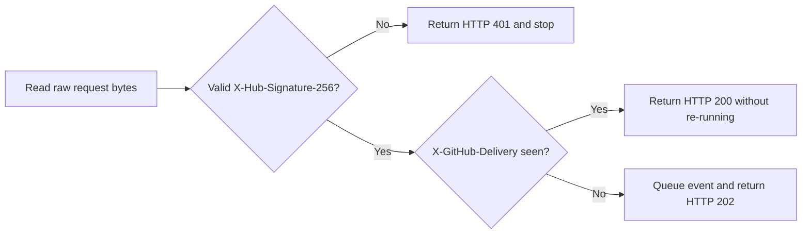

# Verify webhook signatures and handle retries

Use this guide to receive GitHub webhook deliveries safely, verify the `X-Hub-Signature-256` header before parsing the event body, and handle duplicate deliveries.

**Audience:** Integration developers building webhook receivers.  
**Environment:** An HTTPS receiver endpoint and Python 3.10 or later.  
**Outcome:** A receiver that rejects unsigned or tampered requests, acknowledges deliveries within the timeout window, and processes retries idempotently.  
**Shows:** Security-first task flow, constant-time HMAC verification, delivery headers, and unit-tested verification code.

Problem: a public webhook URL accepts HTTP `POST` requests from the internet, so a receiver that parses JSON before checking the signature is open to spoofed events, and a receiver that runs slow tasks inline times out and triggers duplicate deliveries. Approach: verify the raw request bytes with HMAC-SHA256 in constant time, deduplicate on the delivery identifier, and acknowledge receipt before running background work. Validation: the verification helper is tested in `test_verify_signature.py` and follows the GitHub webhook specification.

The [authorship and validation record](../portfolio-evidence/README.md) identifies the writer-owned decisions, AI-assisted work, checks, and limitations for this flagship sample.



## Before you begin

Configure a webhook secret with high entropy and store it in your receiver's secret manager or environment variable, such as `GITHUB_WEBHOOK_SECRET`. Never hard-code the secret in source files or write it to application logs.

Ensure that your web framework exposes the raw request body bytes before JSON deserialization. Re-serializing a parsed JSON object can change whitespace or key order, which changes the SHA-256 digest and causes valid signatures to fail verification.

## Inspect the delivery headers

Each webhook `POST` request includes headers that identify the event, delivery attempt, and signature.

| Header | Purpose in the receiver |
| --- | --- |
| `X-Hub-Signature-256` | HMAC-SHA256 hex digest of the raw request body, prefixed with `sha256=`. |
| `X-GitHub-Delivery` | Unique GUID for the delivery. Use this value as an idempotency key. |
| `X-GitHub-Event` | Event name, such as `issues` or `pull_request`. |
| `User-Agent` | Starts with `GitHub-Hookshot/`. Useful for request logging, not authentication. |

Do not rely on `User-Agent` or source IP addresses alone to authenticate a webhook. Any client can set a header string. Always verify `X-Hub-Signature-256` when a secret is configured.

<!-- pagebreak -->

## Verify the payload signature

1. Read the raw request body as bytes before parsing JSON.
2. Read the `X-Hub-Signature-256` header from the incoming request.
3. Compute the HMAC-SHA256 digest using your UTF-8 encoded webhook secret and the raw payload bytes.
4. Compare the expected `sha256=<hex>` string with the header value using a constant-time comparison function.
5. Reject the request with HTTP `401` or `403` if the header is missing, uses an unexpected prefix, or does not match.

The repository includes [`verify_signature.py`](verify_signature.py):

```python
"""Verify a GitHub webhook HMAC-SHA256 signature."""

import hashlib
import hmac


def verify_github_signature(
    payload_body: bytes,
    secret_token: str,
    signature_header: str | None,
) -> bool:
    """Return True if signature_header matches payload_body."""
    if not signature_header or not secret_token:
        return False
    if not signature_header.startswith("sha256="):
        return False
    expected_mac = hmac.new(
        secret_token.encode("utf-8"),
        msg=payload_body,
        digestmod=hashlib.sha256,
    )
    expected_signature = "sha256=" + expected_mac.hexdigest()
    return hmac.compare_digest(expected_signature, signature_header)
```

Use `hmac.compare_digest` instead of the `==` operator. Standard string comparison returns early on the first mismatched byte, which can leak timing information about the expected digest.

## Acknowledge fast and deduplicate retries

GitHub expects a `2xx` response within 10 seconds. If the receiver takes longer or returns a `5xx` status, the delivery is marked as failed.

1. Verify `X-Hub-Signature-256` first.
2. Check whether the `X-GitHub-Delivery` identifier has already been processed. If it exists in your deduplication store, return HTTP `200` and skip processing.
3. Write the event and `X-GitHub-Delivery` identifier to a queue or durable store.
4. Return HTTP `200` or `202` before running downstream API calls, database migrations, or notifications.

Webhook delivery is at-least-once, and events can arrive out of order. When updating state from an event payload, compare the event timestamp or fetch the current resource state from the REST API before applying a change.

<!-- pagebreak -->

## Run the verification unit tests

The companion test file [`test_verify_signature.py`](test_verify_signature.py) tests a valid signature, a tampered payload, a missing header, and an unsupported digest prefix.

From the repository root, run:

```text
python -m unittest discover -s projects/webhook-integration -p "test_*.py"
```

A successful run reports three tests and `OK`.

## Troubleshoot webhook verification

| Symptom | Cause and fix |
| --- | --- |
| Every delivery fails signature verification | Confirm that the receiver hashes the raw request bytes, not a re-serialized JSON object or decoded string with altered line endings. Confirm that `GITHUB_WEBHOOK_SECRET` has no trailing newline. |
| Duplicate actions run for one event | The receiver took longer than 10 seconds to respond, or an operator redelivered the event. Record `X-GitHub-Delivery` and return `200` before running slow tasks. |
| `X-Hub-Signature-256` header is missing | No secret is configured on the webhook in repository or organization settings. Add the secret in GitHub and redeploy the receiver secret. |
| Out-of-order state updates | A `closed` event was processed before an `opened` event. Check the resource state or timestamp before overwriting newer data. |

## Rotate a webhook secret without downtime

During secret rotation, a single-secret receiver rejects deliveries while the sender and receiver update at different times. To rotate without dropping events, accept a list of active secrets during the transition window: test `verify_github_signature` against the current secret first, then against the previous secret. After updating the secret in GitHub and confirming that new deliveries validate against the new secret, remove the old secret from the receiver configuration.

## References

- [Validating webhook deliveries](https://docs.github.com/en/webhooks/using-webhooks/validating-webhook-deliveries)
- [Webhook events and payloads](https://docs.github.com/en/webhooks/webhook-events-and-payloads)
- [Best practices for using webhooks](https://docs.github.com/en/webhooks/using-webhooks/best-practices-for-using-webhooks)
- [Python hmac.compare_digest documentation](https://docs.python.org/3/library/hmac.html#hmac.compare_digest)
